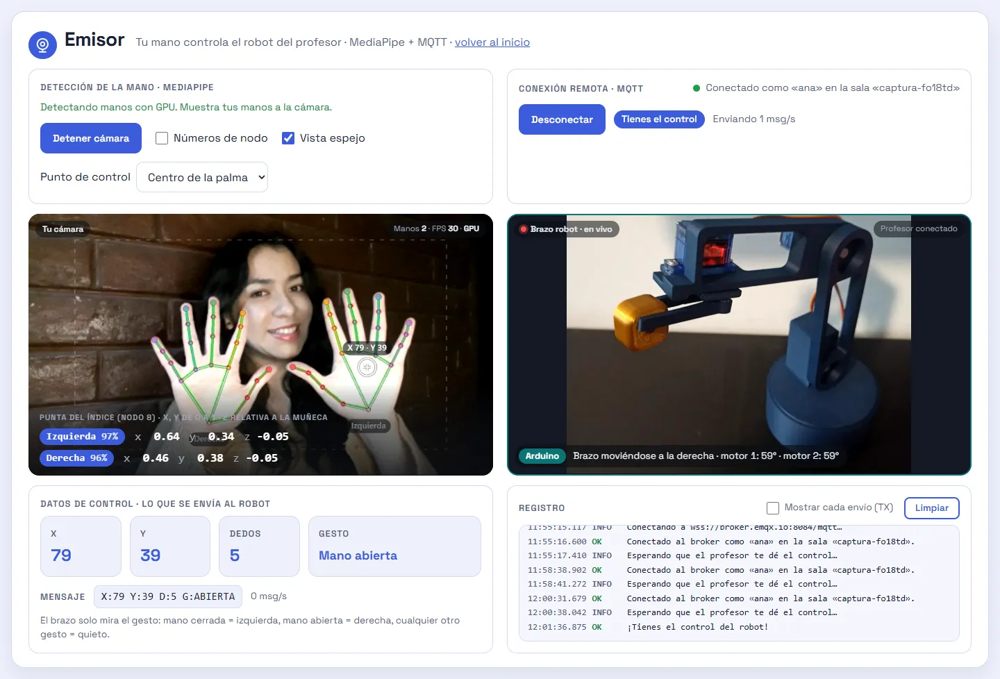
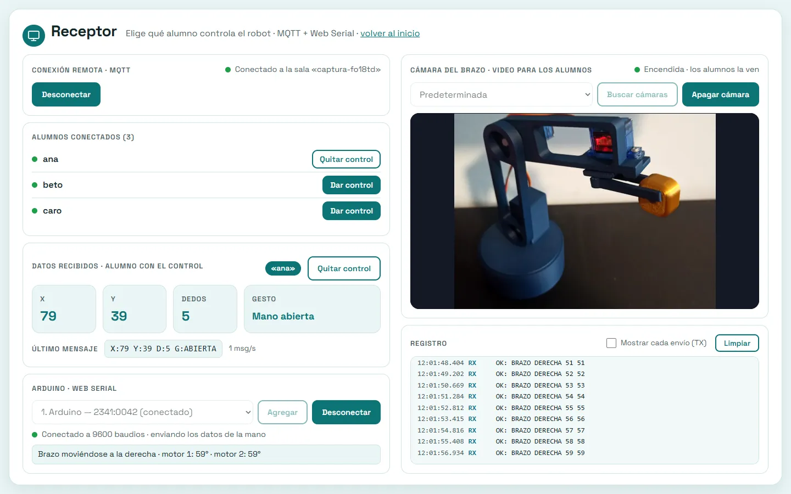
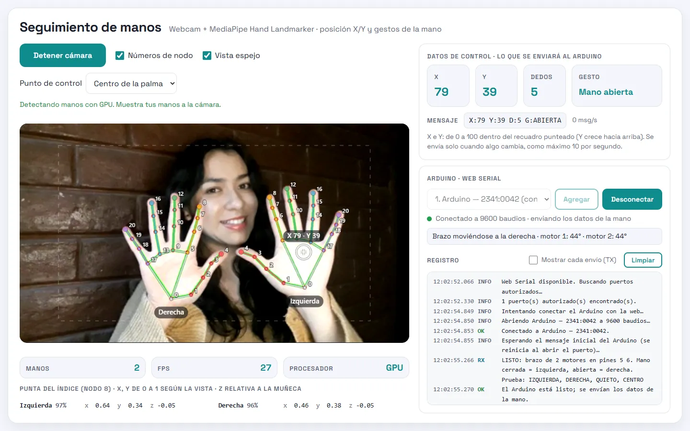

# Brazo robot por gestos

Un alumno mueve la mano frente a su webcam y, a miles de kilómetros, un Arduino responde.

Proyecto del curso de robótica con Arduino: control remoto de un robot con gestos de la mano, usando solo tecnologías web.

- **MediaPipe** detecta los 21 puntos de la mano en el navegador y los convierte en posición (X, Y), cantidad de dedos y gesto.
- **MQTT** lleva esos datos por internet, de un país a otro, a través de un broker en la nube (EMQX).
- **Web Serial** envía los datos desde el navegador del profesor al Arduino por USB.
- **VDO.Ninja** transmite en vivo la cámara que filma el brazo, para que el alumno vea el resultado de sus gestos.

El Arduino puede tener uno de dos sketches, y las páginas se adaptan solas al que esté cargado:

- **LEDs:** enciende 1, 2 o 3 LEDs según la cantidad de dedos.
- **Brazo robot de 2 motores:** con la mano cerrada los dos motores se mueven a la izquierda; con la mano abierta, a la derecha.

Todo el sistema se explica en una **infografía interactiva** ([`arquitectura.html`](arquitectura.html)). Es un diagrama navegable con recorrido guiado, temas a fondo, escenarios de falla y las piezas del robot en 3D a tamaño real.

## Así se ve

**El alumno (emisor).** A la izquierda, su cámara con los 21 puntos de cada mano. A la derecha, el brazo del profesor en vivo. Abajo, los datos que se envían: posición, dedos y gesto.



**El profesor (receptor).** Los alumnos conectados, con el botón para darles el control. También muestra los datos que llegan de quien lo tiene, el Arduino conectado por Web Serial y la cámara del brazo que ven los alumnos.



**La versión local.** Cámara y Arduino en la misma PC: la mano, los datos que se envían y el Arduino conectado, en una sola página.



Las capturas usan datos de ejemplo y se generan con un script ([más abajo](#capturas-y-vista-previa)).

## Páginas

| Página | Para quién | Qué hace |
|---|---|---|
| [`index.html`](index.html) | Todos | Portada: elegir el rol. |
| [`emisor.html`](emisor.html) | Alumnos | Detecta la mano con la webcam, publica los datos cuando el profesor le da el control y muestra el brazo en vivo. |
| [`receptor.html`](receptor.html) | Profesor | Lista a los alumnos conectados, elige quién controla el robot, reenvía sus datos al Arduino y transmite la cámara del brazo. |
| [`hand-tracking.html`](hand-tracking.html) | Pruebas | Versión local: cámara y Arduino en la misma PC, sin internet de por medio. |
| [`arquitectura.html`](arquitectura.html) | Todos | Infografía interactiva: cómo funciona por dentro, del gesto del alumno al motor del robot. |

El receptor y la versión local necesitan **Chrome o Edge de escritorio** (Web Serial no está en otros navegadores). Todas las páginas tienen que abrirse desde `https://` o `http://localhost`:
- la cámara y Web Serial solo funcionan en orígenes seguros;
- desde `file://` (abriendo el archivo con doble clic), el navegador bloquea los módulos de JavaScript.

## Cómo funciona

```
 Alumno (emisor.html)              Broker MQTT (EMQX Cloud)            Profesor (receptor.html)
┌──────────────────────┐   wss   ┌────────────────────────────┐  wss  ┌──────────────────────┐  USB  ┌─────────┐
│ webcam + MediaPipe   │────────▶│ robotica/<sala>/alumnos/…  │──────▶│ valida el mensaje    │──────▶│ Arduino │
│ "X:52 Y:31 D:2 G:V"  │         │ robotica/<sala>/control    │       │ y lo envía por       │       │ 3 LEDs  │
│ ve si tiene control  │◀────────│ robotica/<sala>/leds       │◀──────│ Web Serial           │◀──────│         │
└──────────────────────┘         └────────────────────────────┘       └──────────────────────┘       └─────────┘
```

1. Cada alumno se conecta con un alias y anuncia que está `online`.
2. El profesor ve la lista y pulsa **Dar control** en uno.
3. Solo ese alumno publica sus datos. Los demás quedan *en espera*, sin gastar el cupo del broker.
4. El receptor valida cada mensaje y lo envía al Arduino. El Arduino confirma cuántos LEDs encendió y esa confirmación les llega a todos los alumnos.

### Protocolo

Una línea de texto por mensaje. Es el mismo formato en todo el recorrido: navegador → broker → navegador → Arduino.

| Mensaje | Significado |
|---|---|
| `X:52 Y:31 D:2 G:V` | X e Y de 0 a 100 (Y crece hacia arriba), D = dedos extendidos (0 a 5), G = gesto |
| `SIN_MANO` | No hay mano, se perdió la conexión o no hay nadie con el control: el robot vuelve a reposo |

Gestos: `ABIERTA`, `CERRADA`, `PINZA`, `INDICE`, `V`, `OTRO`. Se reconocen midiendo los 21 puntos de la mano: no usan un segundo modelo de IA.

### Topics MQTT

| Topic | Publica | Contenido |
|---|---|---|
| `robotica/<sala>/alumnos/<alias>/estado` | Emisor (y el broker, con el *Last Will*) | `online` / `offline`, retenido |
| `robotica/<sala>/alumnos/<alias>/mano` | Emisor, solo con el control | Mensaje del protocolo |
| `robotica/<sala>/control` | Receptor | Alias de quien controla (vacío = nadie), retenido |
| `robotica/<sala>/leds` | Receptor | `OK: LEDS n` confirmado por el Arduino, retenido |
| `robotica/<sala>/brazo` | Receptor | `OK: BRAZO <estado> <ángulo 1> <ángulo 2>` informado por el brazo, retenido |
| `robotica/<sala>/receptor` | Receptor (y el broker, con el *Last Will*) | `online` / `offline`, retenido |
| `robotica/<sala>/video` | Receptor | `VIDEO <id> <clave>` del video del brazo (vacío = cámara apagada), retenido |

### Video del brazo

El profesor enciende la cámara del brazo en el receptor y cada alumno la ve a la derecha de su propia cámara. El video va por [VDO.Ninja](https://vdo.ninja), un servicio gratuito y de código abierto que transmite video entre navegadores con WebRTC, sin servidor propio.

1. Al pulsar **Encender cámara**, el receptor genera un ID y una clave al azar y abre la cámara en un iframe de VDO.Ninja (`?push=<id>`).
2. Publica `VIDEO <id> <clave>` retenido en `robotica/<sala>/video`. Así el link solo lo conocen los usuarios del broker y cambia en cada encendido.
3. El emisor valida ese mensaje y arma el visor (`?view=<id>`). Si el profesor apaga la cámara o se desconecta, el video desaparece.

- **Privacidad.** Solo se transmite la cámara del brazo, sin audio (`&audiodevice=0`). El iframe del emisor no tiene permiso de cámara ni de micrófono: no puede usar la webcam del alumno, que sigue sin salir de su PC.
- **Ancho de banda.** Es P2P: la PC del profesor sube un stream por cada alumno que mira. El tope por alumno está en `videoMaxBitrateKbps` ([`js/config.js`](js/config.js)); con 5 alumnos a 1000 kbps son unos 5 Mbps de subida.
- **Redes difíciles.** Si dos PCs no pueden conectarse directo, VDO.Ninja usa sus propios servidores de relevo (TURN).
- **Cámara.** Si la PC del profesor tiene más de una, **Buscar cámaras** las lista por nombre (pide permiso de cámara una vez).

### Seguridad y fallas

- **Sin secretos en el código.** El sitio es público, así que el usuario y la contraseña del broker se escriben en la página al conectarse. Nunca se guardan en el repositorio.
- **Permisos por rol en el broker.** El usuario `emisor` no puede publicar en `control`, así que ningún alumno puede darse el control a sí mismo.
- **Validación en dos capas.** El receptor descarta todo mensaje que no respete el formato exacto, y el sketch del Arduino vuelve a validar.
- **Sala y alias restringidos.** Solo aceptan minúsculas, números y guiones. Así no se pueden usar los comodines de MQTT (`+`, `#`) para meterse en los topics de otros.
- **Si algo falla, el robot recibe `SIN_MANO`.** Pasa cuando un alumno cierra la pestaña o pierde internet (el broker publica su *Last Will*), cuando la pestaña del alumno queda en segundo plano y cuando el receptor pierde el broker.
- **"Hombre muerto" en dos niveles.** Las páginas repiten el estado actual aunque la mano esté quieta. El emisor lo repite cada 1 s y el receptor se lo repite al Arduino cada 0,4 s.
  - Si el alumno con el control deja de enviar durante 3 s, el receptor detiene el robot.
  - Si el Arduino del brazo deja de recibir mensajes durante 2 s, frena los motores por su cuenta.
  - Los tiempos de las páginas están en [`js/config.js`](js/config.js) (`heartbeatMs`, `serialKeepaliveMs`, `handStaleMs`); el del Arduino, en el sketch.
- **Dejar visible la pestaña del receptor.** El navegador frena los temporizadores de las pestañas ocultas: el latido hacia el Arduino baja a 1 por segundo y queda menos margen antes del frenado.

Cada una de estas fallas se puede ver paso a paso en la infografía, en **Si algo falla**.

## Puesta en marcha

### 1. Broker (EMQX Cloud Serverless, plan gratuito)

1. Crear un deployment *Serverless* en [EMQX Cloud](https://www.emqx.com/en/cloud/serverless-mqtt).
2. En **Access Control → Authentication**, crear dos usuarios: `emisor` (lo comparten los alumnos) y `receptor` (solo el profesor).
3. En **Access Control → Authorization**, cargar estas reglas. En cada usuario, las reglas se evalúan en orden y la última deniega todo lo demás.

   | Usuario | Acción | Topic | Permiso |
   |---|---|---|---|
   | `emisor` | Publicar | `robotica/+/alumnos/+/estado` | Permitir |
   | `emisor` | Publicar | `robotica/+/alumnos/+/mano` | Permitir |
   | `emisor` | Suscribirse | `robotica/+/control` | Permitir |
   | `emisor` | Suscribirse | `robotica/+/leds` | Permitir |
   | `emisor` | Suscribirse | `robotica/+/receptor` | Permitir |
   | `emisor` | Suscribirse | `robotica/+/brazo` | Permitir |
   | `emisor` | Suscribirse | `robotica/+/video` | Permitir |
   | `emisor` | Publicar y suscribirse | `#` | Denegar |
   | `receptor` | Suscribirse | `robotica/+/alumnos/+/estado` | Permitir |
   | `receptor` | Suscribirse | `robotica/+/alumnos/+/mano` | Permitir |
   | `receptor` | Publicar | `robotica/+/control` | Permitir |
   | `receptor` | Publicar | `robotica/+/leds` | Permitir |
   | `receptor` | Publicar | `robotica/+/receptor` | Permitir |
   | `receptor` | Publicar | `robotica/+/brazo` | Permitir |
   | `receptor` | Publicar | `robotica/+/video` | Permitir |
   | `receptor` | Publicar y suscribirse | `#` | Denegar |

4. En [`js/config.js`](js/config.js), poner en `brokerUrl` la dirección (*Address*) del deployment, con el puerto WebSocket seguro y la ruta `/mqtt`. Queda así: `wss://<EMQX_HOST>:8084/mqtt`. La dirección no es un secreto (queda visible en la página publicada); las credenciales nunca van en este archivo.

**Límites del plan gratuito a tener en cuenta:**
- 10 publicaciones por segundo por cliente. El emisor envía como máximo 5.
- Una cuota mensual de minutos de sesión y de tráfico. Conviene cerrar las pestañas al terminar la clase.

### 2. Arduino

Hay dos sketches. Los dos usan el mismo mensaje, así que las páginas no cambian: se carga uno u otro en el Arduino.

**LEDs:** [`arduino/hand_leds/hand_leds.ino`](arduino/hand_leds/hand_leds.ino)

- 3 LEDs con la pata negativa (cátodo) en los pines 8, 9 y 10, y la positiva a 5V con una resistencia de 220 a 330 Ω cada uno. Con este montaje el LED se enciende con `LOW`.
- Si los LEDs están conectados al revés, cambiar `LED_ACTIVE_LOW` a `false`.
- Para probar sin la web, escribir `LEDS 2` en el Monitor Serie a 9600 baudios.

**Brazo robot de 2 motores:** [`arduino/brazo_2_motores/brazo_2_motores.ino`](arduino/brazo_2_motores/brazo_2_motores.ino)

| Gesto | Movimiento |
|---|---|
| Mano cerrada (`G:CERRADA`) | Los dos motores giran de a poco hacia la izquierda mientras se mantiene el gesto |
| Mano abierta (`G:ABIERTA`) | Los dos motores giran de a poco hacia la derecha |
| Cualquier otro gesto, o `SIN_MANO` | Quietos donde están |

- **Conexión:**
  - La señal de cada servo va a los pines 5 y 6.
  - Los servos se alimentan con una **fuente externa de 5 a 6 V**, con el GND unido al del Arduino. El USB no alcanza para dos servos en movimiento y el Arduino se reinicia.
  - En el curso se usa una fuente de PC (ATX) reciclada: su salida de 5 V alimenta los servos, y el cable verde (PS_ON#) va unido a GND con un puente para que arranque sin una PC. No hay que abrir la fuente: adentro hay tensión de red.
- **Ajustes en el sketch:**
  - Topes de cada motor: `MIN_ANGLE` / `MAX_ANGLE`. Conviene empezar con un rango chico.
  - Posición de reposo: `HOME_ANGLE`.
  - Velocidad: `DEGREES_PER_SECOND`.
  - Si un motor gira al revés por cómo está montado: `REVERSED`.
- **Para probar sin la web,** escribir en el Monitor Serie `IZQUIERDA`, `DERECHA`, `QUIETO` o `CENTRO`.
- **El brazo informa su estado** (`OK: BRAZO IZQUIERDA 72 72`). El receptor y el emisor lo muestran en lugar de los LEDs.
- **Requiere la librería `Servo`,** que viene con el IDE de Arduino.

### 3. Probar en la PC

```bash
python -m http.server 8000
```

Abrir `http://localhost:8000` en Chrome o Edge.

Para probar sin cuenta de EMQX, en **Servidor** (al final de la fila de conexión) se puede usar el broker público de pruebas `wss://broker.emqx.io:8084/mqtt`. Es abierto, así que conviene elegir una sala con un nombre poco común.

### 4. Publicar (GitHub Pages)

El sitio es estático: no necesita compilación. En el repositorio, ir a **Settings → Pages → Deploy from a branch → `main` / raíz**.

## Infografía: cómo funciona por dentro

[`arquitectura.html`](arquitectura.html) explica el proyecto completo sin que haga falta leer el código. Está pensada para alumnos que nunca vieron el montaje en persona.

- **Diagrama navegable.** Todo el sistema en un lienzo a pantalla completa:
  - zoom y desplazamiento con mouse, pellizco o teclado;
  - paquetes animados que muestran por dónde viaja cada dato;
  - capas: datos de la mano, estado y control, video, energía, carga de la página y seguridad;
  - un panel con información desplegable para cada componente.
- **Así se ve.** En el panel de cada componente que tiene pantalla, una captura de la página real con marcas numeradas que explican cada parte.
- **Recorrido guiado.** 13 pasos, del gesto del alumno al motor del robot.
- **Temas a fondo.** Una pestaña por tema:
  - **Hardware:** esquema de cables, simulador del pulso del servo, Uno o Mega;
  - **El mensaje:** simulador que arma la línea con `formatMessage()` y la valida con `parseMessage()`, el mismo código del receptor;
  - **MQTT:** topics y permisos;
  - **Video:** cómo viaja por WebRTC;
  - **Seguridad:** los tiempos de cada protección;
  - **La web:** de qué está hecho el sitio.
- **Si algo falla.** 8 escenarios que se reproducen sobre el diagrama, con sus tiempos: el alumno pierde internet, se desconecta el USB, la página del profesor se cuelga, etc.
- **Piezas en 3D.** Un banco de trabajo con la placa (Uno o Mega), los servos SG90, el brazo, la fuente ATX y los cables, a escala 1:1. Tiene vista explotada, la ficha técnica de cada pieza y un brazo que se mueve como el sketch.

Los números que muestra la infografía (tiempos, intervalos, topics, formato del mensaje) salen del código: `config.js`, `protocol.js` y `mqtt-link.js`. Si cambian ahí, cambian en la página.

### De dónde salen las medidas del 3D

- **Placas:** del CAD oficial de Arduino, en formato Eagle (A000066 y A000067). [`tools/eagle-a-json.mjs`](tools/eagle-a-json.mjs) extrae el contorno, los agujeros y la posición de cada componente a [`data/`](data/). Para regenerarlos, seguir los pasos de [`data/LICENCIA-CAD.md`](data/LICENCIA-CAD.md).
- **Servo SG90:** cotas del dibujo de TowerPro.
- **Fuente ATX:** formato estándar, 150 × 86 × 140 mm.
- **Lo que no se pudo verificar** figura como «aproximado» en la ficha de cada pieza: las alturas de los componentes de la placa, el ventilador y el conector de la fuente y las piezas de plástico del brazo.

El 3D usa [three.js](https://threejs.org) r187, que se descarga recién al abrir el banco.

El guion con las decisiones de contenido y las fuentes consultadas está en [`docs/arquitectura-guion.md`](docs/arquitectura-guion.md).

## Capturas y vista previa

Las capturas del README, de la infografía y de las tarjetas de la portada no se sacan a mano: las genera un script. Si cambia una página, se vuelven a generar y las marcas numeradas de la infografía siguen en su lugar.

```bash
node tools/capturas.mjs
node tools/vista-previa.mjs
```

- **[`tools/capturas.mjs`](tools/capturas.mjs)** arma una clase de prueba en navegadores sin ventana (Edge o Chrome), conectados al broker público en una sala al azar:
  - el profesor tiene un Arduino simulado y la foto del brazo como cámara;
  - tres alumnos, uno de ellos con la foto de manos como cámara y el control del robot;
  - al final, la versión local.

  Guarda los recortes en [`assets/capturas/`](assets/capturas/), y la posición de cada elemento señalado en `capturas.json`.
- **La foto de manos** es [`tools/fotos/manos.jpg`](tools/fotos/manos.jpg). Se publica con permiso de la persona que aparece y es solo para las capturas de este proyecto. Para usar otra foto: `--mano <foto>` (y `--brazo <foto>` para la del brazo).
  - **Tiene que traer dibujados los puntos de MediaPipe** (puntos rojos, como las imágenes de su documentación). En un navegador sin ventana, MediaPipe no detecta manos. Por eso, el script lee los puntos de la foto y se los entrega a la página en lugar de MediaPipe. Todo lo demás (X, Y, dedos, gesto, MQTT, el mensaje al Arduino) es el código real.
  - Si en la foto aparece una persona, hace falta su permiso para publicarla.
- **[`tools/vista-previa.mjs`](tools/vista-previa.mjs)** genera `assets/vista-previa.jpg` (1200 × 630). Es la imagen que muestran LinkedIn, WhatsApp y otras redes al compartir un enlace del sitio, y cada página la declara en sus etiquetas `og:image`. El diseño está en [`tools/vista-previa.html`](tools/vista-previa.html) y usa dos de las capturas: conviene correrlo después de `capturas.mjs`.

Requisitos: Node 22 o posterior, Edge o Chrome instalado (o su ruta en la variable `NAVEGADOR`) e internet.

## Estructura

```
index.html, emisor.html, receptor.html, hand-tracking.html   páginas del proyecto
arquitectura.html      infografía interactiva
css/app.css            estilos compartidos (dos columnas en escritorio, una en celulares)
css/arquitectura.css   estilos de la infografía
js/hand-tracker.js     cámara, MediaPipe, gestos y datos de control
js/serial-link.js      conexión con el Arduino por Web Serial
js/mqtt-link.js        conexión con el broker (MQTT.js sobre wss)
js/video-link.js       video en vivo del brazo con VDO.Ninja (links, ID y clave al azar)
js/protocol.js         formato y validación de los mensajes
js/logger.js           registro de eventos en pantalla
js/config.js           dirección del broker y parámetros, incluidos los tiempos de seguridad (sin credenciales)
js/arquitectura.js            infografía: diagrama, zoom, capas, recorrido y escenarios de falla
js/arquitectura-contenido.js  infografía: textos y datos (componentes, conexiones, pasos, escenarios)
js/arquitectura-temas.js      infografía: temas a fondo, gráficos y simulador del mensaje
js/arquitectura-3d.js         infografía: banco de trabajo 3D con three.js
js/arquitectura-capturas.js   infografía: capturas «Así se ve» con marcas numeradas y visor ampliado
assets/capturas/       capturas de las páginas con datos de ejemplo, y capturas.json con la posición de las marcas
assets/vista-previa.jpg  imagen para la vista previa al compartir el enlace
data/                  placas Arduino en JSON para el 3D, derivadas del CAD oficial (CC BY-SA 4.0)
tools/eagle-a-json.mjs convierte un archivo .brd de Eagle en el JSON de data/
tools/capturas.mjs     genera las capturas de assets/capturas/
tools/fotos/manos.jpg  foto de manos que usa capturas.mjs como cámara del alumno (con permiso de quien aparece)
tools/vista-previa.mjs genera assets/vista-previa.jpg a partir de tools/vista-previa.html
docs/                  guion de la infografía
arduino/hand_leds/     sketch de LEDs: 1 a 3 LEDs según los dedos
arduino/brazo_2_motores/  sketch del brazo: 2 servos, mano cerrada = izquierda, abierta = derecha
arduino/led_13/        sketch de la primera clase: LED del pin 13 con ENCENDER / APAGAR desde el Monitor Serie
```

## Tecnologías

[MediaPipe Hand Landmarker](https://ai.google.dev/edge/mediapipe/solutions/vision/hand_landmarker) · [MQTT.js](https://github.com/mqttjs/MQTT.js) · [EMQX Cloud](https://www.emqx.com/en/cloud) · [Web Serial API](https://developer.mozilla.org/docs/Web/API/Web_Serial_API) · [VDO.Ninja](https://vdo.ninja) · [three.js](https://threejs.org) · Arduino. Sin frameworks ni compilación: HTML, CSS y JavaScript.

## Licencias de terceros

- Los datos de las placas ([`data/placa-*.json`](data/)) son una obra derivada del CAD oficial de Arduino y se comparten bajo la misma licencia, [CC BY-SA 4.0](https://creativecommons.org/licenses/by-sa/4.0/deed.es). El detalle está en [`data/LICENCIA-CAD.md`](data/LICENCIA-CAD.md).
- three.js se usa desde su CDN, con licencia MIT.

## Próximos pasos

- Control proporcional del brazo: X/Y → base y hombro, pinza → garra.
- Medir la demora entre países con un ping de ida y vuelta.
- Banco 3D: sumar un display que muestre los datos recibidos y potenciómetros.
